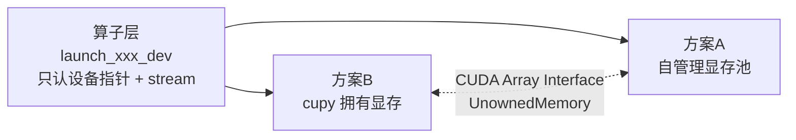
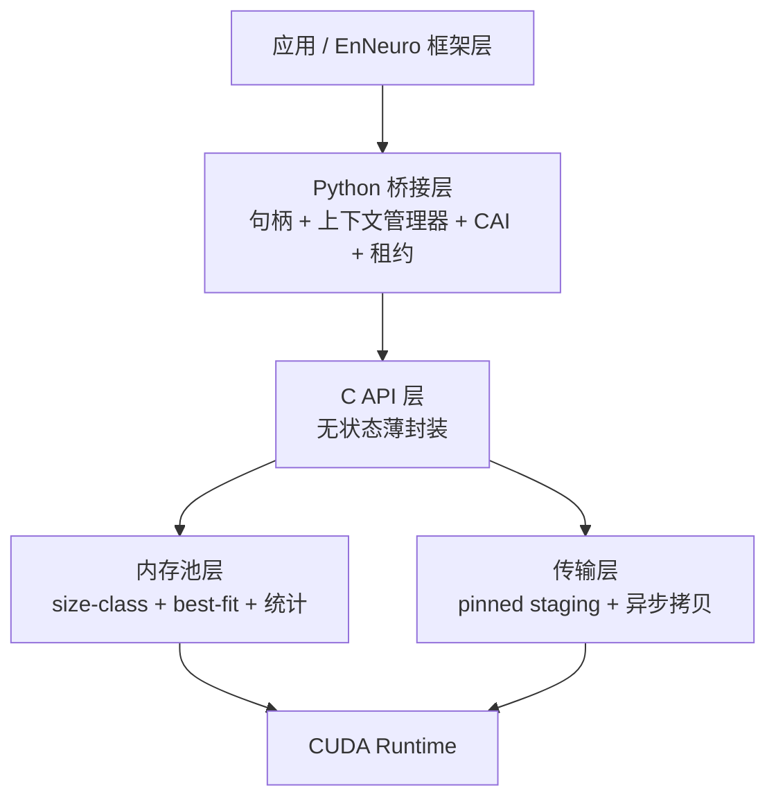
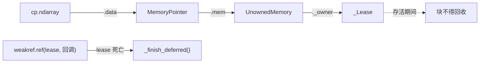
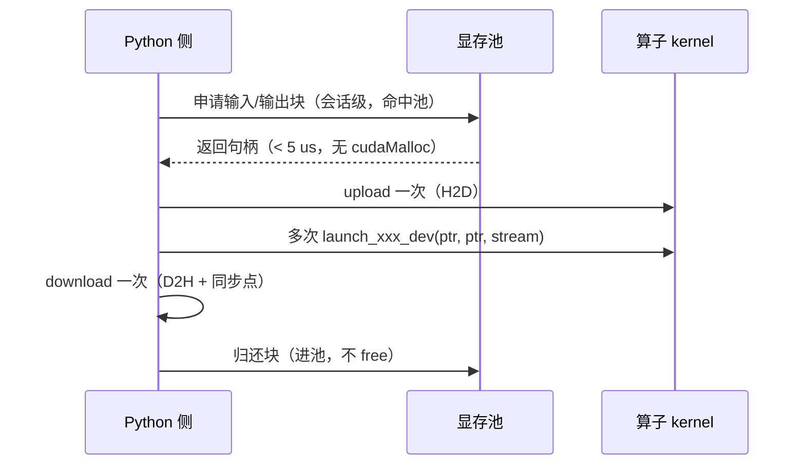
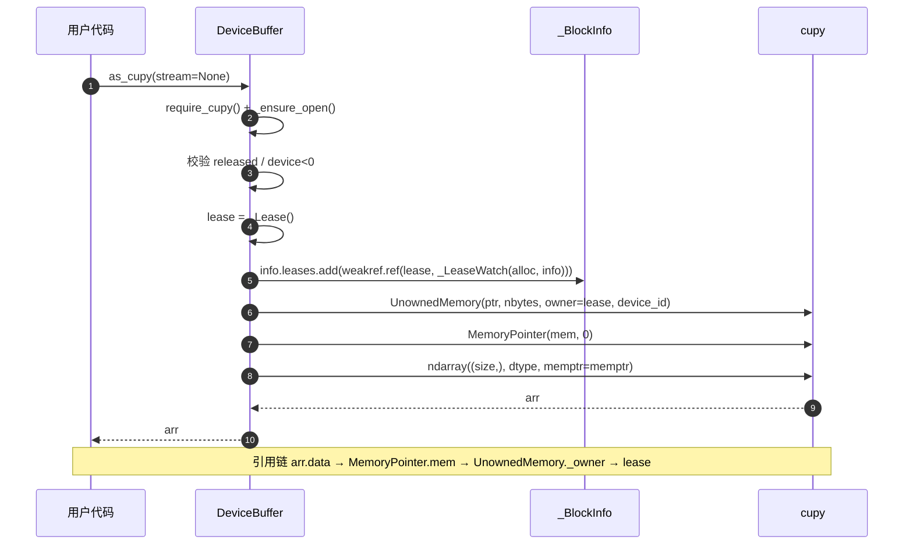
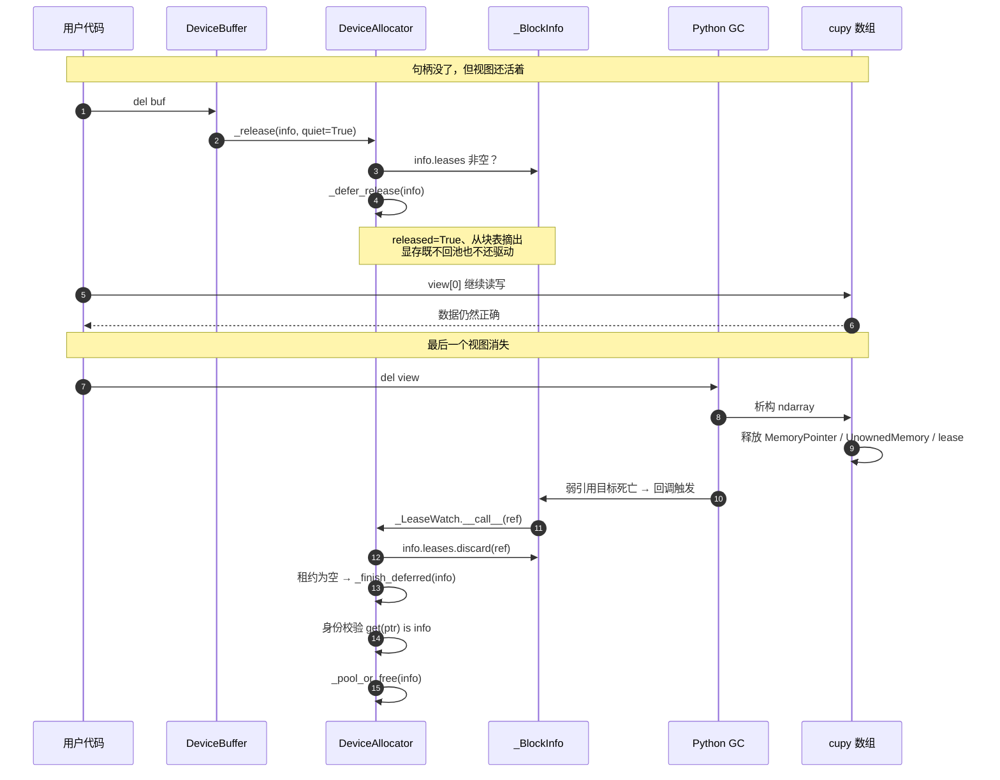
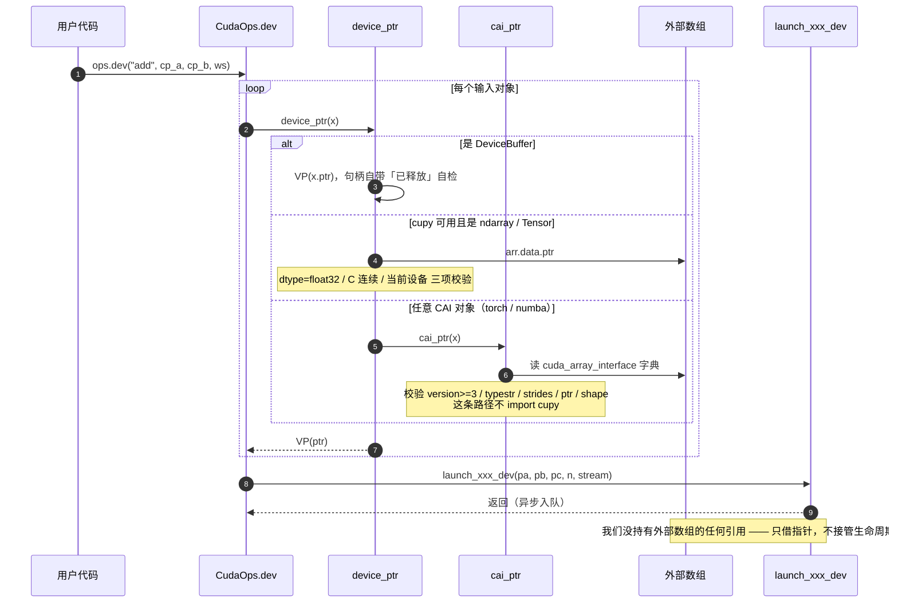

# 显存管理（方案A：自管理显存常驻）

> 本文只描述**当前状态**：定位、需求、设计、API、实测与已知限制。
> 各阶段的实现过程、被测试抓出的问题与当时的取舍，见 [`显存管理-实现记录.md`](./显存管理-实现记录.md)。
>
> 算子接口与编译步骤见 [`算子编写与运行步骤.md`](./算子编写与运行步骤.md)；
> 可运行的用法示例见 `code/tests/test_dev_memory*.py`。

---

## 一、背景与定位

### 1.1 两套算子入口

`code/eneuro/cuda/` 下 13 个算子各有两套入口：

| 接口 | 显存归属 | 实测耗时（n=1e6, RTX 4060 Laptop） |
|------|----------|-----------------------------------|
| `launch_xxx`（host 版） | 无（每次临时分配） | 1.6 ~ 2.5 ms |
| `launch_xxx_dev`（dev 版） | 调用方（cupy，或本模块的池） | 0.011 ~ 0.035 ms |

host 版慢的根因完全可解释：

- 每次调用 3 次 `cudaMalloc` + 3 次 `cudaFree`；实测 4 MB 块的一对 malloc+free 约 **0.30 ms**，3 对 ≈ 0.88 ms；
- 每次 H2D + D2H，n=1e6 的 8 MB 往返约 **1.64 ms**（PCIe ≈ 5 GB/s）；
- 耗时严格正比于拷贝次数（3 次 ≈ 2.4 ms，2 次 ≈ 1.6 ms，1 次 ≈ 0.85 ms），**与 kernel 计算无关**。

方案B（复用 cupy 的 `ndarray.data.ptr`）把这部分开销彻底消掉，但前提是
**显存必须由 cupy 提供**。

### 1.2 方案A 的定位

> 由本模块负责分配、复用、传输和释放设备显存；算子在运行时只接受别人给的设备指针。

它不替代方案B，只覆盖方案B 覆盖不了的三类场景：

1. **没有 cupy 的环境** —— 纯 numpy 用户、精简部署包、CI 机器；
2. **需要自己控制内存布局** —— 融合算子的 workspace、对齐/分块要求、显存用量需要设上限；
3. **需要跨调用复用同一块缓冲** —— 训练循环里反复使用的中间激活区。

### 1.3 与方案B 共用算子接口

两者**共用同一套 `launch_xxx_dev(设备指针..., stream)`**，区别只在「谁拥有显存」：



因此方案A **不新增任何算子签名**。互操作两个方向都支持：

```python
with mem.alloc(n, name="ws") as ws:      # 池里长期复用的 workspace
    arr = ws.as_cupy()                    # 方案A → cupy：零拷贝 + 租约
    arr[:] = 1.0                          # cupy 直接写
    ops.dev("add", cp_a, cp_b, ws)         # cupy 输入 + 池输出，同一个 kernel
```

- **池 → 外部**：`DeviceBuffer` 实现 CUDA Array Interface v3；`as_cupy()` 用
  `UnownedMemory` 零拷贝包装并登记租约（见 5.5）。
- **外部 → 算子**：`device_ptr()` 接受 `DeviceBuffer`、`cupy.ndarray`、
  `device='cuda'` 的 `Tensor`，以及**任何**实现 `__cuda_array_interface__` 的对象
  （torch / numba）。后者的校验路径不导入 cupy。

### 1.4 明确不做的事（非目标）

- 不做通用深度学习内存分配器（不做自动碎片整理、不做显存超分/换出）；
- 不做多卡 P2P / NVLink 通信；
- 不做跨进程显存共享；
- 不接管用户 tensor 的生命周期 —— **只管理自己分配的那部分显存**。

---

## 二、功能需求（FR）

### FR-1 设备内存分配与释放

| 编号 | 需求 | 验收标准 |
|------|------|----------|
| FR-1.1 | 提供设备内存分配/释放原语，返回带元数据的句柄 | 可分配任意字节数并释放 |
| FR-1.2 | 分配失败必须显式返回错误 | 区分「显存不足」与其他 CUDA 错误，不崩溃、不静默返回空指针 |
| FR-1.3 | 分配按 256 B 对齐 | 便于后续向量化访存（`float4` 需 16 B，256 B 留出余量） |
| FR-1.4 | 记录每块的设备号与字节数 | 可查询任意句柄的元数据 |

### FR-2 内存池

| 编号 | 需求 | 说明 |
|------|------|------|
| FR-2.1 | 释放的块进入池等待复用，不立即归还驱动 | 消除热路径上的 `cudaMalloc`（约 0.25 ms/次） |
| FR-2.2 | 按 size-class 分桶，桶内 best-fit | 兼顾速度与碎片，见 5.1 |
| FR-2.3 | 超大块**可配置**为直通分配、不进池 | 默认全部进池；用 `pool_max_block=N` 把大于 N 字节的块排除在池外 |
| FR-2.4 | 提供池统计：命中率、峰值占用、块数、碎片率 | 可输出到日志与基准脚本 |
| FR-2.5 | 提供 `trim` 接口按需归还显存 | 显存紧张时主动收缩 |
| FR-2.6 | 池的空闲总量上限可配，超出按 FIFO 驱逐 | 避免大块长期占显存 |

### FR-3 主机 ↔ 设备传输

| 编号 | 需求 | 说明 |
|------|------|------|
| FR-3.1 | `upload` / `download` 各有同步与异步两种 | 异步版必须接收 stream |
| FR-3.2 | 支持锁页（pinned）主机内存作为 staging | 异步拷贝的前提；pinned 分配本身很贵，必须池化 |
| FR-3.3 | 大块传输可自动分片 | 避免单次超大拷贝造成长尾与调度抖动 |
| FR-3.4 | 提供「传输与计算重叠」的最小能力（双缓冲） | 见 5.2 与 8.3 |
| FR-3.5 | 传输失败必须上报，且不得留下半写状态 | 错误路径需可恢复 |

### FR-4 生命周期管理

| 编号 | 需求 | 说明 |
|------|------|------|
| FR-4.1 | 三级生命周期：设备级池 / 会话级 / 调用级临时 | 见 5.3 |
| FR-4.2 | 引用计数或显式 `release`，禁止裸指针游离 | 句柄失效后再次使用必须报错 |
| FR-4.3 | 必提供上下文管理器（`with` 语义），异常路径也要回收 | 保证 `finally`/析构都归还到池 |
| FR-4.4 | 双重释放必须被检测并报错 | 句柄置失效标记 |
| FR-4.5 | 进程退出时输出未释放块清单 | 泄漏自证 |

### FR-5 与算子接口对接

| 编号 | 需求 | 说明 |
|------|------|------|
| FR-5.1 | 复用现有 `launch_xxx_dev(..., stream)`，**不新增签名** | 内存管理与算子解耦 |
| FR-5.2 | 从句柄取裸设备指针是零成本操作（O(1) 查表） | 热路径不得有线性扫描 |
| FR-5.3 | 输出缓冲可由调用方指定，算子绝不隐式分配 | 保证「稳态零 `cudaMalloc`」 |
| FR-5.4 | 与现有 13 个算子全部对齐（含 `sum`/`dot` 的 `d_out` 常驻标量缓冲） | 归约结果不产生 D2H |

### FR-6 生态互操作

| 编号 | 需求 | 说明 |
|------|------|------|
| FR-6.1 | 受管块实现 `__cuda_array_interface__` | 使 cupy / torch / numba 能零拷贝读取 |
| FR-6.2 | 可被 `UnownedMemory` 包装，且 owner 保活语义正确 | 必须防止「cupy 数组还活着但块已被池回收」，见 5.5 |
| FR-6.3 | 传入的 numpy 数组不做隐式 H2D | 除显式 `upload` 外一律不转换，避免悄悄产生拷贝 |
| FR-6.4 | 支持「用户数据走 cupy、workspace 走池」的混合模式 | 同一个 `launch_xxx_dev` 调用里可以混用 |

### FR-7 流与并发

| 编号 | 需求 | 说明 |
|------|------|------|
| FR-7.1 | 每个块记录「最后一次被哪个流使用」 | 跨流复用前需同步或等待事件（尚未实现，见第九节） |
| FR-7.2 | 所有涉及设备的 API 都接收 stream，默认 0（默认流） | 与现有算子签名一致 |
| FR-7.3 | 跨流复用默认关闭 | 默认安全优先 |

### FR-8 多设备

| 编号 | 需求 | 说明 |
|------|------|------|
| FR-8.1 | 块绑定 device id，跨设备访问**必须报错**，不得隐式拷贝 | 与 `device_ptr` 现有校验保持一致 |
| FR-8.2 | 当前设备与块设备不一致时给出明确错误信息 | 提示应包含两个设备号（尚未强制校验，见第九节） |
| FR-8.3 | 池按设备隔离 | 每设备独立空闲链表（尚未实现，见第九节） |

### FR-9 观测与诊断

| 编号 | 需求 | 说明 |
|------|------|------|
| FR-9.1 | 统计：分配次数、池命中次数、传输字节数 | 可直接被基准脚本消费 |
| FR-9.2 | debug 模式下做越界/溢出哨兵检查 | release 模式必须零开销（未实现） |
| FR-9.3 | 泄漏检测：未释放块清单 + 分配点信息 | 便于定位 |

### FR-10 回退与兼容

| 编号 | 需求 | 说明 |
|------|------|------|
| FR-10.1 | 无 CUDA 环境时 API 不崩，回退到主机内存 | 算子层走 CPU 实现 |
| FR-10.2 | 保留现有 host 朴素接口作为对照与兜底 | 不删除 |
| FR-10.3 | 池不可用时（首次分配失败）自动降级为直通分配 | 功能可用性优先于性能 |

### FR-11 线程安全

| 编号 | 需求 | 说明 |
|------|------|------|
| FR-11.1 | 池的分配/释放线程安全，锁粒度按设备划分 | 不同设备互不阻塞（目前单锁） |
| FR-11.2 | **不得在持锁状态下调用阻塞式 CUDA API** | 否则可能死锁 |
| FR-11.3 | Python 侧句柄表需保证 GIL 外的内存安全 | 必要时加细粒度锁 |

---

## 三、非功能需求（NFR）

| 编号 | 指标 | 目标 / 实测 |
|------|------|-------------|
| NFR-1 | 池命中时的分配开销 | 目标 < 5 µs；实测 **2.4 ~ 2.7 µs**，与块大小无关 |
| NFR-2 | 相对 host 接口的提速（n=1e6，常驻缓冲） | 目标 ≥ 100x；实测 **≈ 247x**（2.54 ms → 0.0103 ms） |
| NFR-3 | 稳态（预热后）热路径上的 `cudaMalloc` 次数 | **0** |
| NFR-4 | H2D 带宽 | 目标 ≥ 基线 5 GB/s 的 85%；实测 pinned **11.8 ~ 12.4 GB/s**、pageable 8.2 ~ 10.6 GB/s |
| NFR-5 | 与方案B 的性能差距 | 目标 ≤ 20%；稳态下实测基本持平（差别只在池查找与 Python 侧开销） |
| NFR-6 | 依赖 | 仅 CUDA Runtime；Python 侧只用 `ctypes` + `numpy`，**核心路径不依赖 cupy** |
| NFR-7 | 平台 | Windows / Linux 单文件动态库 + 单个 Python 模块 |
| NFR-8 | 稳定性 | 10^6 次分配/释放后无泄漏、无碎片增长；实测 20 万次后空闲块数收敛 |
| NFR-9 | 代码规模 | C/CUDA 层 **488 行**；Python 层单模块 **1603 行**（句柄化、池、延迟回收、租约都在 Python 层，见 D1） |
| NFR-10 | 可诊断性 | `allocator.stats()` / `leak_report()` 一条命令输出池快照与未释放清单 |

---

## 四、总体设计

### 4.1 分层



### 4.2 关键设计决策

| 编号 | 决策 | 理由 |
|------|------|------|
| D1 | **句柄化落在 Python 层**，C 层保持无状态 | C 层代码量小一个数量级；块表用 dict 天然 O(1)。C 层不面向最终用户 |
| D2 | **元数据放主机侧**，设备端不加块头 | 设备端加头会改变返回指针（破坏对齐）并增加一次访存 |
| D3 | **池与算子解耦** | 算子是纯函数式（指针 + stream），内存策略可独立演进，也便于与方案B 共用 |
| D4 | **默认异步 + 显式同步** | 与 cupy 语义对齐；同步点由调用方决定，才能做流水线 |
| D5 | **单一所有者原则** | 一块显存同一时刻只能属于一个分配器（我们的池 *或* cupy 池），避免双重回收 |
| D6 | **默认安全、可选激进** | 跨流复用默认关闭；`strict_interop=True` 可禁用「瞬时借出」；`pool_max_block` / `pool_max_bytes` 控制常驻量 |
| D7 | **租约只做存活性探针，不转移所有权** | 用 `UnownedMemory`（绝不 `free`）承载 owner，释放责任始终在分配器 |

### 4.3 风险与对策

| 风险 | 后果 | 对策 |
|------|------|------|
| 显存泄漏 | 训练后期 OOM | 上下文管理器 + `__del__` 兜底 + 退出清单 + `deferred_blocks` |
| 碎片积累 | 明明有空闲却分配失败 | size-class + 碎片率指标 + `trim` + `pool_max_bytes` |
| 跨流复用竞态 | **静默算错**（最危险） | 默认关闭跨流复用；安全前提是**单流**（见第九节） |
| 与 cupy 池冲突 | 双重回收 / 悬垂 | 单一所有者原则 + `UnownedMemory` 边界 + 租约 |
| 外部视图悬垂 | 静默读写别人的张量 | `as_cupy()` 登记租约；`release()` 默认拒绝；`strict_interop` |
| 双重释放 | 崩溃或静默破坏他块数据 | 句柄失效标记（`released`） |
| 设备不匹配 | 崩溃或写错显存 | 块记录 device；`as_cupy` 用显式 `device_id`（严格校验见第九节） |
| pinned 内存分配慢 | 异步收益被吃掉 | pinned staging 必须池化 |
| 过度设计 | 复杂度失控 | 守住「非目标」清单；尚未实现的项集中在第九节列出 |

---

## 五、模块设计

### 5.1 内存池

**size-class 划分**

| 区间 | 步进 / 分桶 | 策略 | 内部碎片 |
|------|-------------|------|----------|
| ≤ 4 KB | 256 B 步进 | 桶内同容量，O(1) pop | ≤ 255 B |
| 4 KB – 1 MB | 2 的幂分桶 | 同上 | ≤ 2x |
| > 1 MB | 精确大小分桶 | 同上 | 0 |

「best-fit」在**桶级别**完成：选最小的、装得下的桶；桶内所有块容量相同，取任意一个即可，
无需遍历比较。需要「超过 N 字节不进池」的行为时传 `pool_max_block=N`。

**块的生命周期**：`空闲` → `已分配` → （可选）`延迟回收` → `空闲`。

`延迟回收` 只在块上还有外部视图（cupy/torch 数组）时出现，见 5.5。

**统计量**：每桶块数/总字节、命中次数、未命中次数、峰值占用、碎片率
（碎片率 = 1 − 最大可服务块 / 空闲总字节）。

**收缩策略**：`trim(older_than=)` 按空闲时长归还驱动；`pool_max_bytes` 限制池的空闲总量，
超出按 FIFO 驱逐最旧的块。

### 5.2 传输子系统

- **pinned staging 池**：`cudaHostAlloc` 的开销量级与 `cudaMalloc` 相当，必须按精确字节数池化，
  否则异步拷贝的收益会被它吃掉（实测 60 次异步上传只发生 2 次 `cudaHostAlloc`）；
- **异步路径**：pinned 主机缓冲 → `cudaMemcpyAsync` → 事件通知；
- **双缓冲**：两条**非阻塞**流 + 每槽一对事件，使第 k+1 批的 H2D 与第 k 批的 kernel 重叠；
- **分片**：单次拷贝超过 `chunk_bytes`（默认 16 MB）时切成多段，降低长尾。

**性能前提（重要）**：重叠收益只对 **pinned 源**成立。pageable 源做异步 H2D 时，
必须先把它 `memmove` 进 pinned staging —— 这段是纯主机开销（8 MB 约 0.5 ~ 0.8 ms/chunk），
与 GPU 工作抢同一段时间。所以正确用法是让生产者**直接写进 pinned staging**：

```python
pin = mem.pinned(n, dtype=np.float32)
... 生产者直接写 pin.array ...        # 没有额外拷贝
slot.upload_async(pin.array)          # 直接 DMA，无主机侧中转
```

### 5.3 三级生命周期

| 级别 | 生存期 | 典型用途 | 释放方式 |
|------|--------|----------|----------|
| 设备级池 | 整个进程 | 权重、embedding、KV cache | 显式 `trim` / 退出 |
| 会话级 | 一次 train / eval 会话 | 重复使用的中间激活区 | 上下文管理器退出 |
| 调用级临时 | 单次算子调用 | workspace、归约输出标量 | 立即归还池（**不是 free**） |

选择原则：**能在会话级分配的，不要放到调用级** —— 每层降级都会增加热路径开销。

### 5.4 与 cupy / torch 共存的边界

| 场景 | 建议 |
|------|------|
| 用户数据本来就在 cupy 里 | 走方案B，零拷贝，不经过我们的池 |
| 需要长期复用的中间缓冲 | 走方案A 的会话级池 |
| 要把我们的块交给 cupy 看（长期持有） | `buf.as_cupy()` —— `UnownedMemory` 的 owner 就是租约，自动保活 |
| 要把我们的块交给 cupy 看（只即时消费） | `cp.asarray(buf)`（瞬时借出，无租约） |
| 要把 cupy/torch 的块交给我们 | 只借指针，不接管生命周期（`device_ptr` 直接接受） |

**红线**：任何时刻一块显存只允许一个所有者负责释放。租约只解决「别人还在看时不要回收」，
**不**转移所有权。

### 5.5 外部视图租约

**要解决的问题**：`cp.ndarray` 只记得一个裸指针，它**不**引用 `DeviceBuffer`。
若句柄被 GC 或显式归还，块回到池里并被下一次 `alloc` 复用，那个数组就会静默地
读到/写错别人的张量。

**机制**：借用 cupy 自己保证的引用链做探针。



`as_cupy()` 的实际步骤：

```python
lease = _Lease()                                        # 零负载标记，只有 __weakref__
info.leases.add(weakref.ref(lease, _LeaseWatch(alloc, info)))
mem = cp.cuda.UnownedMemory(info.ptr, info.nbytes, lease, info.device)   # 只包装，绝不 free
arr = cp.ndarray((info.size,), dtype=info.dtype,
                 memptr=cp.cuda.MemoryPointer(mem, 0))
```

三个必要的取舍：

| 做法 | 结果 |
|------|------|
| 直接在块上存 `lease` 对象 | ❌ 形成「块 → 集合 → lease → 块」的引用环，`lease` 永远死不了 |
| `WeakSet` | ❌ 能自动摘牌，但拿不到「最后一个视图消失」这个**回调时机** |
| `weakref.ref(lease, 回调)` | ✅ 能摘牌，也能触发真正的回收 |

**延迟回收三态**：

| 时刻 | 状态 |
|------|------|
| `del buf`（还有视图） | 句柄立即失效（`released=True`）、从块表摘出；**显存既不入池也不还驱动** |
| 视图还活着 | 数据完全可用；块在 `deferred_blocks` 里；因为显存没还，同一地址不可能被再分配 |
| 最后一个视图被 GC | 弱引用回调 → `_finish_deferred()` → 现在才入池（或还驱动） |

**身份校验**：延迟表虽然按 `ptr` 索引，但回收时必须校验对象身份
（`_pending_release.get(ptr) is info`）—— 因为 `release(force=True)` 之后同一地址
可能已被新块占用，按 `ptr` 盲弹会错杀新块。

**释放策略**：

| 调用 | 租约未清时的行为 |
|------|------------------|
| `buf.release()` | 抛 `BufferLeasedError`（附剩余视图数与处置建议） |
| `buf.release(force=True)` | 照常归还（调用方自担视图悬垂） |
| `with buf:` 退出 / `__del__` | 静默转入延迟回收，不报错也不造成悬垂 |
| `allocator.close()` | 不等待视图；若仍有视图存活则打印一行警告后归还 |

### 5.6 两种「借出」的语义

| | `__cuda_array_interface__`（如 `cp.asarray(buf)`） | `as_cupy()` |
|---|---|---|
| 开销 | 零（只构造一个 dict） | 一次 `UnownedMemory` + `ndarray` 构造 |
| 租约 | **不登记** | 登记，并阻止回收 |
| 数组活得比句柄久 | ⚠️ 悬垂风险 | ✅ 安全（自动延迟回收） |
| 适用 | 一次性表达式、`torch.as_tensor(...)` 即刻消费 | 任何需要长期持有数组的场景 |

`__cuda_array_interface__` 只是一次属性访问，字典交给对方之后我们就**无从知道对方把数组
留多久** —— 这是协议本身的限制。需要长期持有一律 `as_cupy()`；想彻底禁用前者，
构造分配器时加 `strict_interop=True`。

字典内容（`shape` 取**请求的** `nbytes` 而非桶容量，桶取整的富余部分不对外暴露）：

| 键 | 值 |
|----|-----|
| `shape` | `(nbytes / itemsize,)` |
| `strides` | `None`（C 连续） |
| `typestr` | `dtype.str`（如 `<f4`） |
| `data` | `(ptr, False)`（可写） |
| `version` | `3` |
| `stream` | 分配器的 `cai_stream`，默认 `0`（legacy 默认流） |

---

## 六、关键流程

### 6.1 一次前向计算（稳态）



要点：**一次进、多次算、一次出**。这与 host 版的「每次调用都进出一遍」是本质区别。

### 6.2 训练迭代

1. 权重与优化器状态：设备级池常驻，全程不搬；
2. 每步的中间激活：会话级池复用同一块（形状固定）；
3. 每个算子的输出：调用方指定 `out`，不隐式分配；
4. 同步点：仅在需要读回 loss / 更新学习率时产生。

### 6.3 异常与中断路径

- 所有分配走上下文管理器；异常时归还到池而非 `free`；
- 传输失败直接抛异常（`OutOfMemoryError` / `InvalidArgumentError` / `DevMemError`），
  不会留下被后续静默使用的半写缓冲；
- 进程退出前打印未释放清单，作为泄漏基线。

### 6.4 互操作：建立租约



### 6.5 互操作：延迟回收



### 6.6 互操作：外部数组喂给算子



---

## 七、API 参考

### 7.1 C API（`dev_memory.dll` / `dev_memory.so`）

| 导出 | 作用 |
|------|------|
| `ene_mem_init(device)` | 初始化；无设备时返回 `ENE_ERR_NODEVICE`（供上层回退） |
| `ene_mem_available()` / `ene_mem_device()` / `ene_mem_device_count()` | 能力查询 |
| `ene_mem_alloc(size)` / `ene_mem_free(ptr)` | 直通分配/释放 |
| `ene_mem_upload(d, h, bytes, stream)` / `ene_mem_download(h, d, bytes, stream)` | 同步语义传输（Async + StreamSynchronize） |
| `ene_mem_upload_async` / `ene_mem_download_async` | 纯异步，不含任何同步 |
| `ene_mem_sync(stream)` | 等待流完成 |
| `ene_mem_stream_create/destroy` | 非阻塞流（`cudaStreamNonBlocking`） |
| `ene_mem_event_create[_timed]/destroy/record/wait/sync/done/elapsed` | 跨流同步 + GPU 侧计时 |
| `ene_mem_host_alloc/free/is_pinned` | 锁页主机内存 |
| `ene_mem_last_code()` / `ene_mem_last_error()` / `ene_mem_error_string(code)` | 错误信息（按线程保存） |
| `ene_mem_alloc_calls/free_calls/upload_bytes/download_bytes/host_alloc_calls` | 计数，用于验证「稳态零分配」 |

错误码：`ENE_OK` / `ENE_ERR_OOM`（显存不足）/ `ENE_ERR_INVALID`（参数非法）/
`ENE_ERR_DEVICE`（设备号非法）/ `ENE_ERR_CUDA`（其他）/ `ENE_ERR_NODEVICE`（无设备）。

### 7.2 Python API（`eneuro.utils.dev_memory`）

**`DeviceAllocator`**

| 成员 | 说明 |
|------|------|
| `device=0, lib_dir=None, force_host=False, name=, pool=True, pool_max_block=None, pool_max_bytes=None, chunk_bytes=16<<20, strict_interop=False, cai_stream=0` | 构造参数 |
| `alloc(size, dtype=float32, name=)` / `alloc_bytes(nbytes, dtype=uint8, name=)` / `alloc_like(ndarray)` | 分配，返回 `DeviceBuffer` |
| `pinned(size, dtype=float32, name=)` | 取锁页内存，返回 `PinnedBuffer` |
| `sync(stream=None)` | 等待流并回收已完成的 staging |
| `new_stream()` / `destroy_stream(s)` | 非阻塞流 |
| `create_event(timed=False)` / `record_event_on` / `wait_event` / `event_sync` / `event_done` / `destroy_event` / `event_elapsed` | 事件原语 |
| `double_buffer(size, dtype=float32, slots=2, name=)` | 双缓冲流水线 |
| `trim(older_than=None)` | 归还池中空闲块 |
| `stats()` / `leak_report()` | 池快照 / 未释放清单 |
| `live_blocks` / `free_blocks` / `deferred_blocks` | 块表视图 |
| `available` / `device` / `mode` | 能力查询 |
| `close()` / `with` | 释放全部显存（幂等） |

**`DeviceBuffer`**

| 成员 | 说明 |
|------|------|
| `ptr` | 裸设备指针；已释放会抛 `BufferReleasedError` |
| `nbytes` / `capacity` / `size` / `dtype` / `device` / `name` / `released` / `leases` | 元数据 |
| `upload(arr)` / `download(arr)` / `to_numpy()` | 同步传输（dtype 一致、C 连续、字节数相等） |
| `upload_async(arr, stream=)` / `download_async(arr, stream=)` | 异步传输；D2H 目标必须锁页 |
| `as_cupy(stream=None)` | 零拷贝包装成 cupy 数组并登记租约 |
| `__cuda_array_interface__` | CAI v3 字典（瞬时借出） |
| `release(force=False)` / `with` | 归还；租约未清时默认报错 |

**`PinnedBuffer`**：`ptr` / `nbytes` / `dtype` / `name` / `array` / `as_numpy()` /
`__array_interface__` / `release()` / `with`。`.array` 与 numpy 视图都**不保活**。

**`DoubleBuffer`**：`next()` / `sync()` / `close()` / `with`；
槽位（`_PipelineSlot`）提供 `buffer` / `compute_stream` / `upload_async(arr)` / `done()`。

**工具函数**：`load_library(lib_dir=None)`、`cupy_available()`、`require_cupy(what)`、
`cai_ptr(x, what=, require_float32=True)` → `(ptr, nbytes)`（**不依赖 cupy**）、`stream_ptr(stream)`。

**异常体系**：`DevMemError` → `OutOfMemoryError` / `InvalidArgumentError` /
`DeviceError` / `BufferReleasedError` / `BufferLeasedError` / `AllocatorClosedError` /
`LibraryNotFoundError`。

### 7.3 算子桥接（`eneuro.utils.cuda_ops`）

| 成员 | 说明 |
|------|------|
| `CudaOps(lib_dir=None)` | 加载 13 个算子库并绑定签名 |
| `.host(spec, a, b, out, scalar=)` | host 指针入口（每次 malloc + 拷贝） |
| `.dev(spec, a, b, out, scalar=, stream=, d_out=)` | 设备指针入口，零拷贝 |
| `device_ptr(x)` | 接受 `DeviceBuffer` / `cupy.ndarray` / `Tensor` / 任意 CAI 对象 |
| `stream_ptr(stream)` | `None`→当前流（无 cupy 时为 0）、`int` **原样透传**、流对象取 `.ptr` |
| `get_op(name)` / `OPS` / `OpSpec` | 算子表（13 个，含 `sum` / `dot` 的 `d_out` 约定） |

`dev` 版的前置条件（不满足就抛错，不静默算错）：dtype 必须是 float32、必须 C 连续、
必须在当前设备上。

---

## 八、实测与验证

环境：RTX 4060 Laptop（L2 24 MB）、nvcc 12.6、Python 3.11、cupy 14.0.1。

### 8.1 三条路径对比（n = 1e6）

| 场景 | 单次耗时 | 相对 host |
|------|----------|-----------|
| host 接口（malloc + 3 次拷贝） | 2.5391 ms | 1x |
| 方案A 单次（上传 + 算 + 下载） | 1.6568 ms | ~1.5x |
| 方案A 复用常驻缓冲（只算） | 0.0103 ms | **~247x** |

**结论**：方案A 的价值不在「单次调用更快」。如果一次 H2D 之后只算一次，
它相对 host 几乎没有优势 —— 这一点必须在选型时说清楚。

### 8.2 内存池

| 块大小 | 不池化（malloc+free，us） | 池命中（us） | 提速 |
|--------|---------------------------|--------------|------|
| 4 KB | 4.36 | 2.42 | 1.8x |
| 64 KB | 4.59 | 2.45 | 1.9x |
| 1 MB | 5.80 | 2.48 | 2.3x |
| **4 MB** | **300.09** | **2.41** | **124.7x** |

| 指标 | 实测 |
|------|------|
| 稳态 `cudaMalloc` 次数（2 万次循环，预热后） | **0** |
| 池命中率 | **99.99%** |
| 分配开销 | **2.4 ~ 2.7 us**，与块大小无关 |
| 长时间稳定性（20 万次） | `live_blocks=0`、`free_blocks=1`（收敛） |

### 8.3 传输与流水线

传输带宽（16 MB 单次 H2D，多轮取最快）：

| 方式 | 带宽 |
|------|------|
| 同步 / pageable | 8.2 ~ 10.6 GB/s（波动较大） |
| **同步 / pinned** | **11.8 ~ 12.4 GB/s（稳定）** |
| 异步 / pinned | 12.0 ~ 12.3 GB/s |
| 异步 / pageable（走 staging） | 5.3 ~ 5.9 GB/s（最慢） |

端到端（6 chunk × 8 MB 拷贝 + 等量计算），相对串行：

| 源 | 加速比 |
|----|--------|
| pinned（直接写 `pin.array`） | **1.22 ~ 1.37x**（稳定） |
| pageable（需 staging 中转） | 0.81 ~ 1.15x（不稳定，可能反而更慢） |

**两个容易搞反的点**：

1. **异步本身不提高纯传输带宽**（12.0 ~ 12.3 vs 同步 pinned 11.8 ~ 12.4）。
   它的价值是「传输能与计算重叠」。
2. **带宽提升来自 pinned，不来自异步**（pageable → pinned 约 1.2 ~ 1.4x）。

### 8.4 生态互操作

| 指标 | 结果 |
|------|------|
| cupy 零拷贝一致性（kernel 写→cupy 读、cupy 写→kernel 读、cupy 算子写进池块、cupy 数组喂算子） | max\|diff\| = **0.0e+00** |
| 句柄删除后视图仍可读 | 块未回池（`free_blocks=0`），进入 `deferred_blocks` |
| 最后一个视图死亡 | `deferred_blocks=0`、`free_blocks=1`（自动回收） |
| 混合模式热路径（n=4096，400 次 kernel） | **15.3 us/轮**、分配增量 **0**、`cudaMalloc` 增量 **0** |
| 非法 CAI 输入 | dtype / 连续性 / 空指针 / `version<3` 全部拦住 |

### 8.5 验收测试

| 套件 | 组数 | 项数 | 覆盖 |
|------|------|------|------|
| `test_dev_memory.py` | 5 | 37 | 分配释放对齐、错误路径、13 算子全流程、统计与泄漏、无 CUDA 回退 |
| `test_dev_memory_pool.py` | 12 | 40 | 命中复用、稳态零分配、开销、分桶、旧句柄失效、`trim`、驱逐、稳定性、算子回归、`close` |
| `test_dev_memory_async.py` | 10 | 37 | pinned、异步正确性、带宽、分片、事件、在飞有界、D2H 锁页要求、双缓冲、自定义流、回退 |
| `test_dev_memory_interop.py` | 9 | 65 | CAI 字典、无 cupy 反读、numpy 视图、零拷贝一致性、租约保活、释放策略、混合模式、`strict_interop`、越界保护 |
| **合计** | **36** | **179** | |

前三套在导入 `eneuro` 前屏蔽了 cupy，因此「全部通过」同时证明了核心路径不依赖 cupy。

### 8.6 复现方式与测量注意

```bash
python code/tests/test_dev_memory.py           # 分配/生命周期/13 算子全流程
python code/tests/test_dev_memory_pool.py      # 池化与稳态零分配
python code/tests/test_dev_memory_async.py     # 异步传输与双缓冲
python code/tests/test_dev_memory_interop.py   # 与 cupy/torch 的零拷贝互操作
python code/tests/bench_dev_memory_pipeline.py # 同步/异步 × 是否流水线 → 柱状图
python code/tests/bench_cu_dev_ops.py          # 13 个算子 host vs dev vs cupy
```

产物：`doc/CUDAC/cu_dev_ops_bar.png`、`doc/CUDAC/cu_async_pipeline_bar.png`。

三条测量纪律（不遵守会得到数量级错误的结论）：

1. **标定 kernel 耗时前必须先预热一次 launch** —— 首次 launch 会加载 CUDA 模块
   （本机约 20 ms），不预热会把这一性开销平均进循环（真实值 17 ~ 23 us）；
2. **取多轮中最快一轮（min-of-rounds）**，单次均值会被抖动抬高；
3. **多算子/多后端对比要轮转交错（round-robin）**，否则先测的会被后测的挤掉
   （实测曾把同一算子测出 2 倍差）。

---

## 九、已知限制

- **跨流复用未防护**：块被 A 流释放后可能立刻被 B 流复用，而 A 流上还有未完成的 kernel。
  当前唯一的安全前提是**单流**（对应 FR-7.3）；
- **池未按设备隔离**：所有设备共用一个块表与空闲链表（FR-8.3）；
- **未强制校验「块所在设备 == 当前设备」**：`as_cupy()` 用显式 `device_id` 包装，
  但跨设备误用不会在分配器层面被拦住（FR-8.2）；
- **C 侧计数器未加锁**：单进程多线程高频分配时计数可能少记，不影响正确性（FR-11.1）；
- **`trim(older_than=)` 需自行定期触发**，没有后台清理；
- **只有一条 copy 流**：多个 chunk 的拷贝彼此串行，重叠收益上限是
  `(拷贝+计算) / max(拷贝,计算)`，实测约 1.3x；
- **`download_async` 要求 pinned 目标**（刻意的：pageable 目标的异步 D2H 实际不会异步）；
- **`__cuda_array_interface__` 的「瞬时借出」无法跟踪**（协议限制）：
  长生命周期场景请用 `as_cupy()`，或开 `strict_interop=True` 封死这条路；
- **`close()` 不等待外部视图**：有视图存活时打印警告后归还显存，此后视图即悬垂；
- **`PinnedBuffer` 的 numpy 视图不保活**：不得活得比 `PinnedBuffer` 久；
- **无 debug 越界哨兵**（FR-9.2 未实现）。

> 以上未实现项已整理为**阶段5（多设备与并发）**的范围与验收标准，
> 见 [`显存管理-实现记录.md`](./显存管理-实现记录.md) 第五节。

---

## 十、选型速查

| 你的情况 | 推荐 |
|----------|------|
| 数据本来就在 cupy 里，且不介意依赖 cupy | **方案B**（零拷贝，不经过我们的池） |
| 需要长期复用的中间缓冲 / workspace | **方案A 会话级池** |
| 部署环境没有 cupy | **方案A** |
| 需要限制显存用量上限 | **方案A**（`pool_max_bytes` + `trim`） |
| 用户数据在 cupy，但想用池化的 workspace | **混合模式**：`ops.dev("add", cp_a, cp_b, ws_buffer)` |
| 要把池里的块交给 cupy/torch 算 | `ws.as_cupy()`；仅即时消费可用 `cp.asarray(ws)` |
| 要给 cupy 喂大量数据且要重叠 | 生产者直接写 `mem.pinned(n).array` 再 `upload_async` |
| 一次 H2D 只算一次 | **都不划算** —— 先考虑合并算子减少往返 |
| 不确定 | 先按方案B 接，把内存策略留成接口；确有需求再上方案A |
